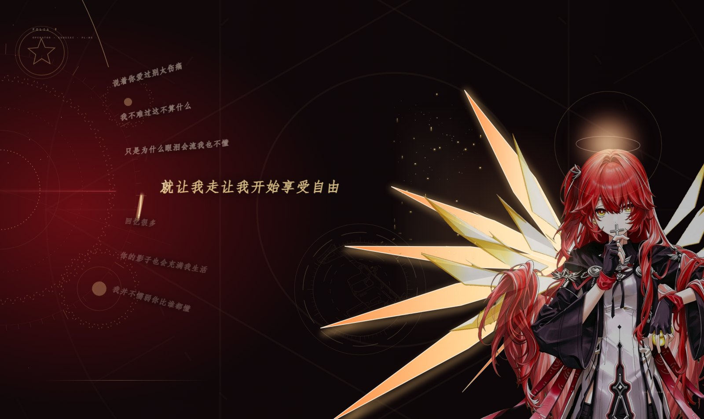
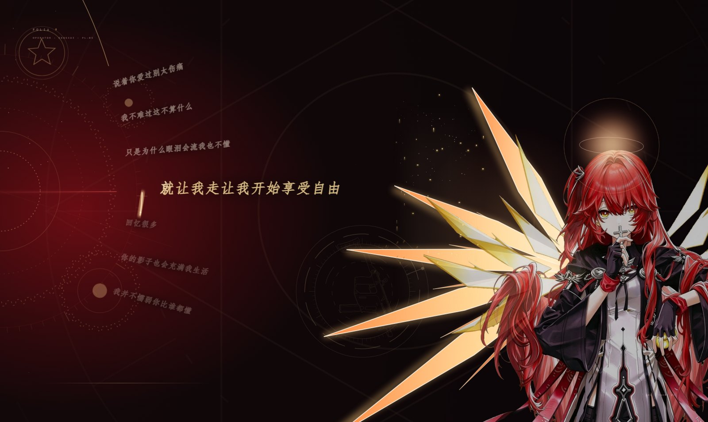
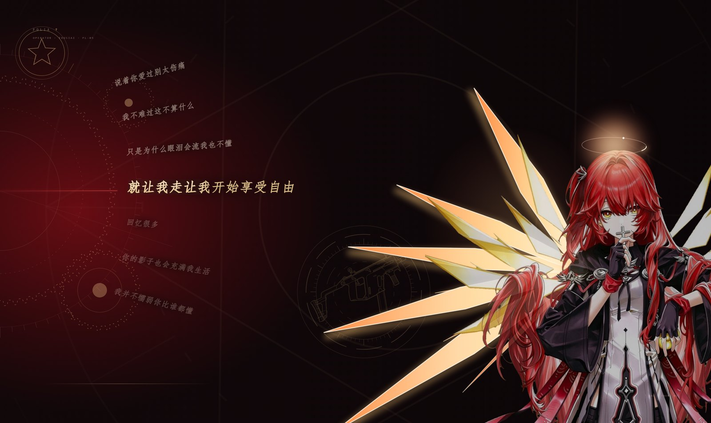

# 圣环 · 弧线（能天使）｜Folia 歌词模组

[](https://github.com/TBK-tbk/folia-exusiai-arc/releases/latest)
[](https://github.com/chthollyphile/folia-major)
[](LICENSE)
[](https://github.com/TBK-tbk/folia-exusiai-arc/releases)
[](https://github.com/TBK-tbk/folia-exusiai-arc/stargazers)

> 一段圆弧把歌词串起来，左边是一只缓慢转动的齿轮刻度盘，右边是能天使。
> 光环既是装饰，也是整首歌的进度环。

> **[⬇ 下载最新版](https://github.com/TBK-tbk/folia-exusiai-arc/releases/latest)**
> 在 Releases 里下载 `Exusiai-Arc-Folium.zip`，解压后把 `mod` 文件夹放进
> `%APPDATA%\Folia\mods\exusiai-arc\`，重启 Folia 即可。



---

## 这是什么

这是一个 [Folia](https://github.com/chthollyphile/folia-major) 的 **Folium 歌词渲染模组**。
它把传统的一行行歌词改成沿圆弧排布：当前句水平居中，上下各三句按 5° 递进旋转，
越远越小、越淡，像一圈正在走动的钟面刻度。

配套的左侧刻度盘会随低频缓慢转动，右边立绘头顶的光环外面套着一条进度弧，
唱到哪儿就亮到哪儿。

除了排版本身，模组还内置 **12 组可独立开关的音频动感效果**（仿真鼓面、刻度脉动、
环形扫光、辉光呼吸、相位差转动、星尘漂移……），默认只开「仿真鼓面」一项，
其余全部关闭 —— 打开多少、开多大，全看你想要多"热闹"。

---

## 预览

| 默认状态 | 相位差转动 + 星尘 |
|---|---|
|  |  |

| 中央法阵 · 维克托线稿 |
|---|
|  |

---

## 安装

1. 确认 Folia 版本在 `0.7.20` ~ `0.7.x` 之间（见 `mod/mod.json` 的 `folia` 字段）。
2. 把 `mod` 文件夹整个复制到：

   ```
   %APPDATA%\Folia\mods\exusiai-arc\
   ```

   复制后目录里应当有：`mod.json`、`client.mjs`、`character.mjs`、`gun.mjs`、`preview.jpg`。
3. **完全退出并重启 Folia**（模组只在启动时扫描）。
4. 首次加载会在模组面板要求确认授权 —— 这是 Folia 的内容摘要校验，正常放行即可。
5. 打开任意歌曲 → 歌词样式 → 选择「圣环 · 弧线（齿轮）」。

> 修改过 `client.mjs` 之后，摘要会变，需要重新确认授权并重启一次。

---

## 设置面板

设置分两块：**版面**（立绘、光环、字体）和**动感效果**（12 组音频联动）。
所有滑块都带中英说明，下面这张表是完整清单。

### 版面

| 选项 | 默认 | 说明 |
|---|---|---|
| 显示立绘 | 开 | 显示右侧能天使立绘 |
| 立绘大小 | 100 | 60–130，100 为原始比例 |
| 立绘淡化 | 30 | 0–100，越高越融入背景 |
| 光环 | 开 | 头顶光环，同时是整首进度环 |
| 歌词字体 | 宋体（粗） | 另有楷体、黑体、跟随主题三种 |

### 动感效果

每一组都是「开关 + 若干滑块」，默认全部关闭（**仿真鼓面除外，默认开**）。

| 组 | 选项 | 默认 | 范围 | 说明 |
|---|---|---|---|---|
| 仿真鼓面 | 开关 | **开** | — | 低频鼓点让圆弧与歌词弹性下陷再回弹 |
| | 鼓面强度 | 1.00x | 0–2 | 凹陷深度与回弹力度 |
| 时序刻度脉动 | 开关 | 关 | — | 鼓点触发时背景刻度环由内向外依次亮起 |
| | 脉动强度 | 0.60x | 0–2 | 刻度环被点亮的亮度 |
| | 衰减速度 | 1.00 | 0.2–3 | 亮点消失的快慢，越大越快 |
| 刻度环形扫光 | 开关 | 关 | — | 暖金流光沿刻度环顺时针扫过 |
| | 扫光亮度 | 0.70x | 0–2 | 扫光与途经刻度的提亮程度 |
| | 扫光速度 | 1.20 | 0–3 | 转动速度，0 为停住 |
| 歌词辉光呼吸 | 开关 | 关 | — | 当前句外发光随音量舒展、收窄 |
| | 辉光范围 | 0.70x | 0–2 | 辉光向外扩散的范围 |
| | 辉光亮度 | 0.80x | 0–2 | 辉光浓淡 |
| 刻度旋动 | 开关 | 关 | — | 背景多层刻度环缓慢自转 |
| | 旋转速度 | 0.25 | 0–1 | 不受音量影响的基础转速 |
| | 音频驱动权重 | 0.40 | 0–1 | 音量对转速的加成 |
| 文字弹性缩放 | 开关 | 关 | — | 鼓点瞬间当前句轻微放大再弹回 |
| | 缩放幅度 | 0.08 | 0–0.3 | 放大幅度，0.08 ≈ 8% |
| | 回弹阻尼 | 8.0 | 2–15 | 越大回得越快越干脆 |
| 低频径向光晕 | 开关 | 关 | — | 低频触发暗红光晕从圆弧中心散开 |
| | 光晕半径 | 0.80x | 0–2 | 最终扩散范围 |
| | 光晕透明度 | 0.30 | 0–1 | 最亮时的不透明度 |
| 圆弧流光拖尾 | 开关 | 关 | — | 暖金光带沿歌词弧滑动，带淡出拖尾 |
| | 拖尾长度 | 0.60x | 0–2 | 越长光带越连贯 |
| | 流光亮度 | 0.70x | 0–2 | 光带亮度，也影响随节拍闪动的强度 |
| 刻度相位差旋转 | 开关 | 关 | — | 内中外三圈刻度差速转动（中间那圈反向） |
| | 转速差 | 0.15 | 0–0.6 | 圈层之间转速差距，0 为同速 |
| | 音频加速权重 | 0.30 | 0–1 | 低频对整体转速的加成 |
| 星尘漂移 | 开关 | 关 | — | 背景暗金星尘缓慢漂浮，鼓点时被吹散再回归 |
| | 星尘数量 | 25 | 0–80 | 星尘点个数 |
| | 漂移速度 | 0.20 | 0–1 | 平时漂浮快慢 |
| 背景径向渐变呼吸 | 开关 | 关 | — | 低频升高时底层背景中心透出暗红柔光 |
| | 呼吸强度 | 0.50x | 0–2 | 中心提亮幅度 |
| | 响应权重 | 0.60 | 0–1 | 低频对亮度的驱动占比 |
| 齿轮刻度分层颜色 | 开关 | 关 | — | 内层暗红、中层橙红、外层暖金 |
| | 色彩偏移强度 | 0.40x | 0–2 | 各层之间的分离程度 |
| | 音频驱动权重 | 0.35 | 0–1 | 音量对颜色差距的加成 |

更详细的逐条说明、推荐搭配与"关掉某一项该注释哪里"，见 **[docs/EFFECTS.md](docs/EFFECTS.md)**。

---

## 推荐组合

| 想要的感觉 | 打开这些 |
|---|---|
| 安静、只跟着鼓点动一下 | 仿真鼓面（默认）+ 文字弹性缩放（幅度 0.05） |
| 机械感、时钟在走 | 刻度旋动 + 刻度相位差旋转 + 刻度环形扫光（亮度 0.5） |
| 高潮时整屏亮起来 | 时序刻度脉动 + 歌词辉光呼吸 + 低频径向光晕 |
| 空灵、尘埃感 | 星尘漂移（数量 45）+ 背景径向渐变呼吸 |
| 全部拉满（不推荐） | 会互相抢戏，建议一次最多开 3～4 组 |

---

## 技术说明

- 纯 Folium 模组，不修改 Folia 本体；卸载 = 删除文件夹。
- 音频数据来自 Folium 的实时分析器：低频用 `ctx.audio.getBands().bass`，
  总能量用 `ctx.audio.getPower()`，节拍由低频起音阈值 + 冷却时间推导。
- 立绘与枪线稿以 base64 data URL 内嵌在 `character.mjs` / `gun.mjs` 里
  —— `folia-mod://` 协议只服务 `.js` / `.mjs`，图片必须以这种形式打包。
- 代码里所有新增效果都用 `// [MOD] 效果名` 注释块包住，方便单独注释停用。

---

## 素材来源与声明

本模组是**非官方同人作品**，与鹰角网络（Hypergryph）、Studio Montagne 及《明日方舟》官方无任何关联，
也不代表其立场。

| 文件 | 内容 | 版权归属 | 来源 |
|---|---|---|---|
| `mod/character.mjs` | 《明日方舟》能天使（Exusiai）立绘 | © 鹰角网络 / 原画师 | 网络公开渠道收集 |
| `mod/gun.mjs` | 维克托（Vector）冲锋枪线稿 | © 原权利方 | 网络公开渠道收集 |
| `screenshots/*.jpg` | 模组运行截图（内含上述素材） | 同上 | 本项目实机截图 |
| `mod/client.mjs` 等全部代码 | 排版、动画与音频效果逻辑 | **MIT**（见 [LICENSE](LICENSE)） | 本项目原创 |

**使用范围**：仅限个人、非商业的播放器装扮与学习交流。
请勿将上述图像用于商业用途、二次售卖或大规模再分发。

**关于版权**：仓库中的角色与武器素材均来自互联网公开渠道，本项目作者并非版权持有人，
也无法追溯到原始出处。若您是权利人或其代理人，认为本仓库内容侵犯了您的权益，
请通过 Issues 联系，我会在收到通知后**尽快移除**相关内容，不设异议。

**想完全规避风险？** 可以把 `mod/character.mjs` 和 `mod/gun.mjs` 换成自己的图片 ——
这两个文件里各自只有一个 base64 data URL，重新生成即可，步骤见 docs/ASSETS.md。

如果这个模组帮到了你，欢迎拿去改、拿去二创，改完记得标注来源即可。

---

## 上传到 GitHub

这个文件夹已经是「可直接 `git init` 并上传」的结构。最快的做法：

```bash
cd Exusiai-Arc-Folium
git init
git add .
git commit -m "feat: 圣环·弧线（能天使）Folia 歌词模组"
git branch -M main
git remote add origin https://github.com/<你的用户名>/<仓库名>.git
git push -u origin main
```

不想用命令行的话：在 GitHub 网页上新建仓库 → 点 **Add file → Upload files** →
把整个文件夹拖进去即可。

**建议的仓库信息**

| 项 | 建议值 |
|---|---|
| Repository name | `folia-exusiai-arc` |
| Description | Folia lyric mod — arc layout, clockwork dial, 12 audio-reactive effects |
| Topics | `folia` `folium` `lyrics` `arknights` `exusiai` `music-visualizer` |
| License | MIT（素材部分见 LICENSE 末尾的例外说明） |

**发布版本**：打完 tag 后可以把 `Exusiai-Arc-Folium.zip` 挂到 Releases 里，
别人下载解压就能直接放到 `%APPDATA%\Folia\mods\` 使用：

```bash
git tag v1.2.0
git push origin v1.2.0
```

---

## 目录结构

```
Exusiai-Arc-Folium/
├─ README.md            ← 你正在看的这份
├─ LICENSE              ← MIT，末尾有素材例外说明
├─ .gitignore
├─ mod/                 ← 整个文件夹复制到 %APPDATA%\Folia\mods\exusiai-arc\
│  ├─ mod.json          ← 模组清单
│  ├─ client.mjs        ← 全部渲染与效果逻辑
│  ├─ character.mjs     ← 立绘（base64 内嵌）
│  ├─ gun.mjs           ← 维克托线稿（base64 内嵌）
│  └─ preview.jpg       ← 模组面板缩略图
├─ docs/
│  ├─ EFFECTS.md        ← 12 组动感效果逐条详解
│  └─ CHANGELOG.md
└─ screenshots/
```

---

## 常见问题

**Q：装好了但在歌词样式里找不到「圣环 · 弧线」？**
A：Folia 只在启动时扫描模组。完全退出（托盘也要退）再启动；如果仍看不到，
检查 `mods\exusiai-arc\` 下是不是**直接**放着 `mod.json`，而不是多套了一层文件夹。

**Q：改了文件之后模组显示未授权？**
A：正常。Folia 用内容摘要校验，改动后需要重新确认一次，并重启。

**Q：设置改完没反应？**
A：滑块是即时的，开关类效果需要下一次节拍/下一句歌词才看得出来；

如果全部都没反应，确认歌曲正在播放（暂停时所有音频驱动效果都会停）。

**Q：能不能只用歌词排版，不要立绘？**
A：设置里关掉「显示立绘」即可，圆弧歌词、齿轮盘、光环都会保留。

